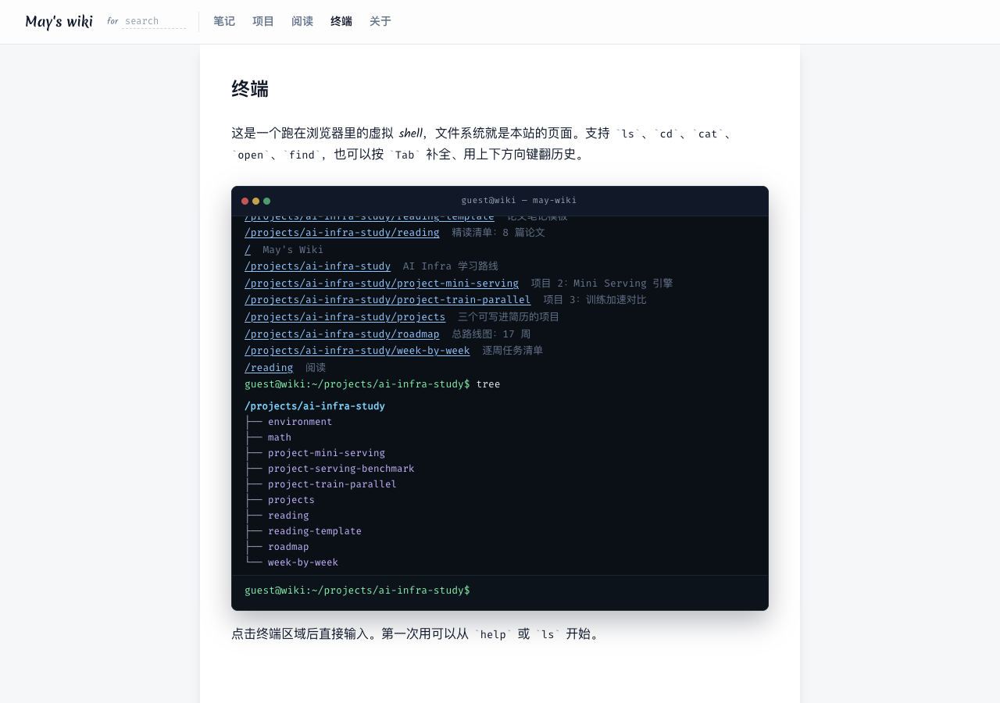

# May's Wiki

一个仿 [jyywiki](https://jyywiki.cn/) 风格的个人 Wiki：白底、窄栏、手写体正文、紫色链接。Markdown 写作，构建成静态 HTML，部署在 GitHub Pages。


线上地址：<https://ipoger.github.io/wiki/>

## 特点

- **纯文本**：`content/` 下每个 `.md` 就是一个页面，可 diff、可回滚。
- **零运行时**：构建产物是静态文件，没有数据库和后台。
- **干净 URL**：`notes/foo.md` → `notes/foo/`，且部署在子路径下链接也不会坏。
- **够用的排版**：KaTeX 公式、highlight.js 代码高亮、表格、脚注式引用。
- **站内搜索**：构建时生成 JSON 索引，浏览器里匹配，无需服务端。
- **站内终端**：`/terminal/` 提供一个虚拟 shell，用 `ls` / `cd` / `cat` / `find` 浏览全部页面。
- **可勾选清单**：学习路线里的任务可以直接打勾，状态存在浏览器本地。
- **自动发布**：push 到 `main` 后由 GitHub Actions 部署到 Pages。

## 站内终端

打开 <https://ipoger.github.io/wiki/terminal/>，或者在导航里点「终端」。

```text
$ help
$ ls
$ cd projects/ai-infra-study
$ cat week-by-week
$ find 上下文
$ open roadmap
```

支持 `Tab` 补全路径、`↑` / `↓` 翻历史、`Ctrl+L` 清屏。文件系统在构建时由 `content/` 生成，新增页面会自动出现在终端里。



## 本地开发

```bash
npm install
npm run build     # 构建到 dist/
npm run dev       # 构建并启动 http://localhost:4173
```

## 目录结构

```text
.
├── build.mjs              # 构建入口
├── site.json              # 站点名、导航、链接
├── content/               # Markdown 源文件
│   ├── index.md           # 首页
│   ├── notes/             # 笔记
│   ├── projects/          # 项目（含 AI Infra 学习路线）
│   ├── reading/           # 阅读清单
│   ├── terminal/          # 虚拟终端
│   └── search/            # 搜索页
├── src/
│   ├── layout.mjs         # HTML 模板
│   ├── markdown.mjs       # Markdown → HTML
│   └── url.mjs            # 链接解析
├── public/                # 静态资源、下载包、终端脚本
└── .github/workflows/     # GitHub Pages 部署
```

## 写一页

在 `content/` 下新建 Markdown 文件：

```markdown
---
title: 页面标题
description: 一句话摘要，会进 meta 和搜索结果。
---

# 页面标题

正文……
```

- `content/notes/foo.md` → `notes/foo/`
- `content/notes/index.md` → `notes/`
- `content/index.md` → `/`

站内链接直接写相对 `.md` 路径，构建时会自动转换：

```markdown
[另一篇](other.md)
```

## 改站点信息

编辑 `site.json`：站名、作者、GitHub 地址、页脚许可、导航。

## 部署

仓库已配置 `.github/workflows/pages.yml`。在 **Settings → Pages → Build and deployment** 中选择 **GitHub Actions**，之后每次 push 到 `main` 都会自动发布。

如果 Pages 尚未启用，也可以用 API 开启：

```bash
gh api --method POST repos/ipoger/wiki/pages -f build_type=workflow
```

## 许可

- 文字内容：[CC BY-NC 4.0](https://creativecommons.org/licenses/by-nc/4.0/)
- 构建脚本与样式代码：[MIT](LICENSE)
